# Components

Each component below has a screenshot and its usage notes. The reference implementation (plain React, no build step) is in `reference/bundle.js` with its styles in `reference/bundle.css` and prop types in `reference/index.d.ts`. Rebuild these as components in the app's framework; read the reference for exact sizes, states and props, but do not ship the bundle itself.

| Component | What it is |
|---|---|
| [Avatar](#avatar) | Round initials avatar (photo when the user uploaded one). Sizes XS 24 · S 32 · M 40 · L 56 · XL 96. |
| [Badge](#badge) | Small status pill with an optional dot. Tones map to meaning, always with a word — never colour alone. |
| [Button](#button) | Pill buttons in three sizes. **Primary** (Majorelle, with the brand glow) is the one action a view exists for — "Request inspection", "Creat |
| [CarPhoto](#carphoto) | Placeholder car image: a studio gradient in one of seven tones with a side-profile silhouette. Stands in for listing photos until real media |
| [Checkbox](#checkbox) | Square checkbox (`radius-xs`), `brand` when checked. Multi-select lists (fuel filter) and consent ("I agree to the Terms"). |
| [ChecklistRow](#checklistrow) | One checklist item from an inspection section with its status (pass / attention / fail), icon, note and badge. Sections: exterior, interior, |
| [Chip](#chip) | Filter and quick-choice chips. Selected chips invert to `ink`. |
| [EquipmentGroup](#equipmentgroup) | One equipment category from the catalog (Safety, Driving assistance, Comfort, Multimedia, Exterior — in catalog `position` order) with its i |
| [EquipmentPill](#equipmentpill) | Selectable pill for one car equipment item (ABS, Apple CarPlay, Panoramic roof…). Off: outlined with a `+`; on: `brand-soft` with a `brand`  |
| [Footer](#footer) | Desktop footer on `night`: dark logo, one-line mission, three link columns, legal line with Arabic and French language links. |
| [Icon](#icon) | Line icons on a 24px grid, 2px stroke, round caps and joins (Lucide-style). The consumer passes `name` and optionally `size` and a token nam |
| [IconButton](#iconbutton) | Round icon-only button (40px) used in headers and on photos: favourite, notifications, share, back. |
| [Input](#input) | Labelled text field, select and textarea in one component. States: default (placeholder), filled, focus (2px `brand` ring), error (red outli |
| [InspectionTimeline](#inspectiontimeline) | The inspection lifecycle: Requested → Accepted → In progress → Report ready. `stage` 0–3 maps to pending, accepted, in_progress, completed;  |
| [LanguageSwitch](#languageswitch) | Language switcher for the three API languages: Français (the API default), English and العربية. Each language name is written in its own lan |
| [ListingCard](#listingcard) | The car card used in every grid: photo with "Inspected · score" badge, favourite heart and photo count; title, meta line (year · mileage · f |
| [Logo](#logo) | The AutoSouk logo: a white car on a Majorelle rounded tile, riding on two saffron zellige-star wheels, with a saffron 8-point star badge in  |
| [MapView](#mapview) | Stylised city map with price pins for garages (`wrench`) or cars (`car`). The active pin is `brand`. Pins take percentage positions; replace |
| [MechanicCard](#mechaniccard) | Garage card: initials avatar, name with verified mark, area, rating, two-line description, inspection price and a request action. Used on ho |
| [MediaLimits](#medialimits) | Counter and rules for a car's media: photos, videos and uploads in progress against the 20-file limit, plus the three rules the API enforces |
| [MobileHeader](#mobileheader) | Mobile top bar: `main` (logo, notifications, avatar) on tab roots; `back` (back, centred title, optional action) on pushed screens. |
| [NavDesktop](#navdesktop) | Desktop top bar (76px): logo, primary links with an active dot, role switch, favourites, notifications and avatar — or Log in / Create accou |
| [Pagination](#pagination) | Round page buttons; the current page is `ink`. Listings use `page`/`limit` from the API. |
| [Radio](#radio) | Single choice inside selectable cards (role picker at sign-up, garage picker in the inspection request). |
| [Rating](#rating) | Five saffron stars with the score and an optional review count. Scores come from mechanic reviews (1–5). |
| [ReviewItem](#reviewitem) | One mechanic review: avatar, name, inspection context, stars and message (≤1000 characters, moderated). The signed-in user's own review show |
| [RoleSwitch](#roleswitch) | Header toggle between the three perspectives (Buyer, Seller, Mechanic). It changes what the UI shows; permissions are always enforced server |
| [ScoreRing](#scorering) | The inspection score (0–100) as a ring coloured by verdict: excellent → `success`, good → `brand`, fair → `warning`, poor → `danger`. Always |
| [Segmented](#segmented) | Segmented control for 2–5 mutually exclusive options that fit on one line (transmission, doors, price sort on mobile). |
| [SpecItem](#specitem) | Icon + overline label + value, for car specs (year, mileage, fuel, gearbox, fiscal power, doors, owners, origin, condition) and report facts |
| [StatCard](#statcard) | Dashboard number card: label, icon, big value (`display-m`) and a trend line coloured by meaning. Seller dashboard, mechanic queue, admin mo |
| [StatusBar](#statusbar) | iOS-style status bar for mobile mock-ups (390 wide). `dark` for white glyphs over photos. |
| [Stepper](#stepper) | Horizontal step indicator for the 4-step listing flow (Listing → Car details → Photos → Review). Done steps turn `success` with a check, the |
| [TabBar](#tabbar) | Mobile bottom navigation (86px with home indicator). Buyers/sellers: Explore, Saved, Sell (raised brand button), Inspections, Account. Mecha |
| [Tabs](#tabs) | Underline tabs with optional counts — listing statuses, review/garage-photo tabs, inspection filters. |
| [Toggle](#toggle) | On/off switch, green when on. Used for "Accepting inspection requests", "Inspected only", contrôle technique and vignette validity. |
| [UploadTile](#uploadtile) | Tile for listing media and garage photos. States: empty (dashed "Add photo"), filled, cover (brand outline + "Cover" tag: the primary image) |
| [ZelligePattern](#zelligepattern) | Moroccan zellige tiling used only inside `night` bands (home hero, auth brand panel, report verdict, footer CTA): Majorelle 8-point star ros |

## Avatar

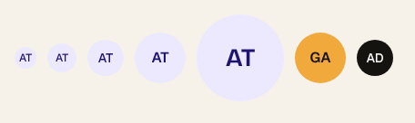

Round initials avatar (photo when the user uploaded one). Sizes XS 24 · S 32 · M 40 · L 56 · XL 96.

- Default tone `brand` (brand-soft / brand-ink); `saffron` marks the #1 ranked garage; `ink` for admin.

## Badge

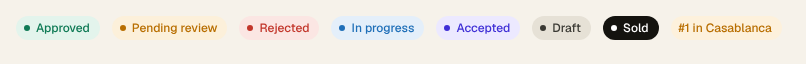

Small status pill with an optional dot. Tones map to meaning, always with a word — never colour alone.

- **success**: Approved, Completed, Inspected, Pass, Email verified · **warning**: Pending, Attention · **danger**: Rejected, Fail · **info**: In progress, Withdrawn · **brand**: Accepted, roles, "Your review" · **neutral**: Draft, facts ("1st owner") · **dark**: Sold · **saffron**: rankings ("#1 in Casablanca").

## Button

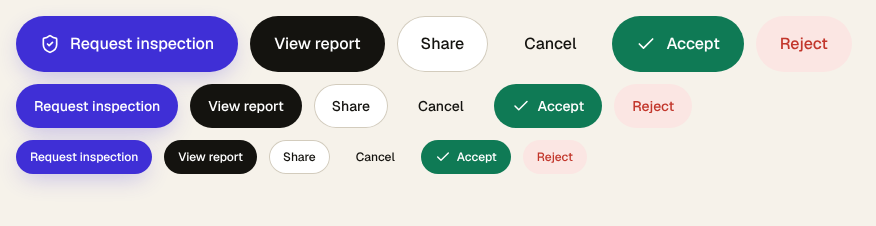

Pill buttons in three sizes. **Primary** (Majorelle, with the brand glow) is the one action a view exists for — "Request inspection", "Create account", "Submit report". Use it once per view.

- **Dark** for the strong secondary action ("Start inspection", "View report"), **Secondary** (outlined) for neutral actions, **Ghost** for low-emphasis ("Cancel", "Save draft").
- **Success** only for Accept / Approve, **Danger** (soft red) for Reject, Withdraw, Log out. **Saffron** is reserved for marketing bands.
- Sizes: L (56) for page-level CTAs and mobile bottom bars, M (44) default, S (34) inside cards and tables.
- Verb first, sentence case: "Send request", not "SEND". Leading icon optional, from the Icon set.

## CarPhoto

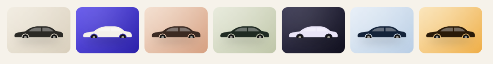

Placeholder car image: a studio gradient in one of seven tones with a side-profile silhouette. Stands in for listing photos until real media loads; children overlay it (badges, buttons).

- Tones: sand, majorelle, clay, olive, night, sky, saffron. Vary tones across a grid. `fluid` fills its container at `ratio` (default 4 / 3).

## Checkbox

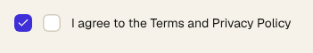

Square checkbox (`radius-xs`), `brand` when checked. Multi-select lists (fuel filter) and consent ("I agree to the Terms").

## ChecklistRow

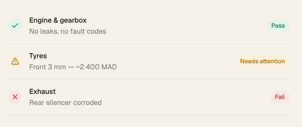

One checklist item from an inspection section with its status (pass / attention / fail), icon, note and badge. Sections: exterior, interior, mechanical, electrical, under vehicle, road test.

## Chip

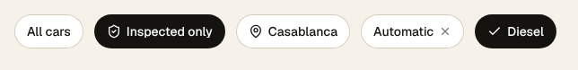

Filter and quick-choice chips. Selected chips invert to `ink`.

- Use for filters ("Inspected only", "Automatic"), applied-filter pills (with `removable`) and single-choice pickers (fuel, condition).
- Keep labels to 1–3 words; counts go inside the label ("Approved 1").

## EquipmentGroup

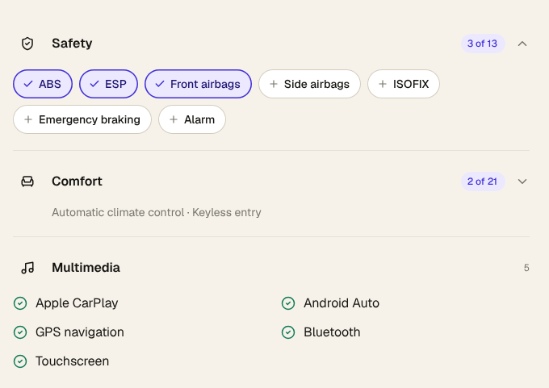

One equipment category from the catalog (Safety, Driving assistance, Comfort, Multimedia, Exterior — in catalog `position` order) with its icon and items.
- `mode="select"` (seller: create/edit listing, buyer: filters) shows every item as an EquipmentPill and a "3 of 13" count. `collapsible` + `open={false}` collapses to a one-line summary of the picks.
- `mode="view"` (listing detail) shows only the car's items as a check list in a fluid grid; pass plain names. `max` caps the visible items and adds "+ N more".
- Category icons: Safety `shield`, Driving assistance `navigation`, Comfort `armchair`, Multimedia `music`, Exterior `car`.
- Stack groups directly; each has a hairline divider (`flush` removes it on the last one).
- API: send the picked ids as `equipmentIds` (≤ 100, unique). On edit the array replaces the whole set and returns the listing to `pending`; as a search filter cars must have **all** the picked items.

## EquipmentPill

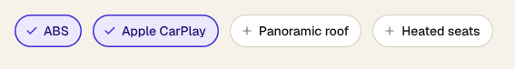

Selectable pill for one car equipment item (ABS, Apple CarPlay, Panoramic roof…). Off: outlined with a `+`; on: `brand-soft` with a `brand` check. It is a checkbox (`role="checkbox"`), not a filter chip — use Chip for filters with ink selection.
- Labels are the catalog `name` (English fallback); in production render the translation keyed by `slug` from `GET /api/equipment`.
- Usually rendered inside EquipmentGroup rather than on its own.

## Footer

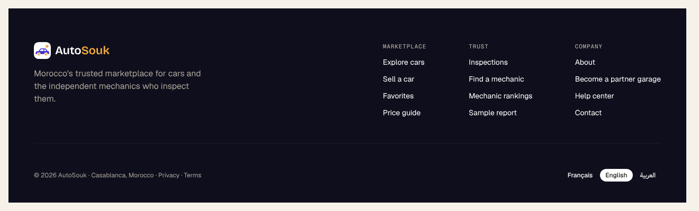

Desktop footer on `night`: dark logo, one-line mission, three link columns, legal line with Arabic and French language links.

## Icon

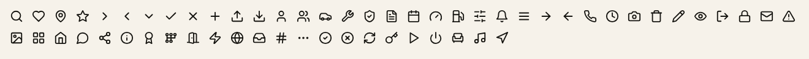

Line icons on a 24px grid, 2px stroke, round caps and joins (Lucide-style). The consumer passes `name` and optionally `size` and a token name as `color`.

- Sizes: 14 in badges and meta lines, 16–18 in buttons and inputs, 20–22 in navigation, 24+ for empty states.
- Colour with a token name (`color="muted"`); `fill` only for the selected heart and rating stars.
- Every file also lives under Assets → Icons.

## IconButton

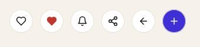

Round icon-only button (40px) used in headers and on photos: favourite, notifications, share, back.

- Always give the surrounding element an accessible label.
- On photos use `bg="surface"`; on `paper` it carries a hairline `line` ring.

## Input

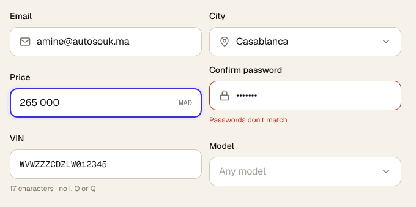

Labelled text field, select and textarea in one component. States: default (placeholder), filled, focus (2px `brand` ring), error (red outline + message), disabled.

- Always give a `label`; put units in `suffix` (MAD, km, CV, / 100) and identifiers in `mono` (VIN, matricule, carte grise).
- `select` adds the chevron; `multiline` for descriptions and summaries (wraps).
- Error copy comes straight from the API validation message ("Passwords don't match", "VIN must be 17 characters…").

## InspectionTimeline

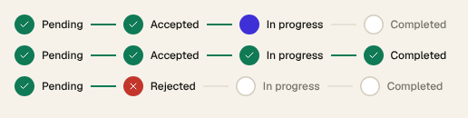

The inspection lifecycle: Requested → Accepted → In progress → Report ready. `stage` 0–3 maps to pending, accepted, in_progress, completed; `rejected` marks step 2 red.

## LanguageSwitch

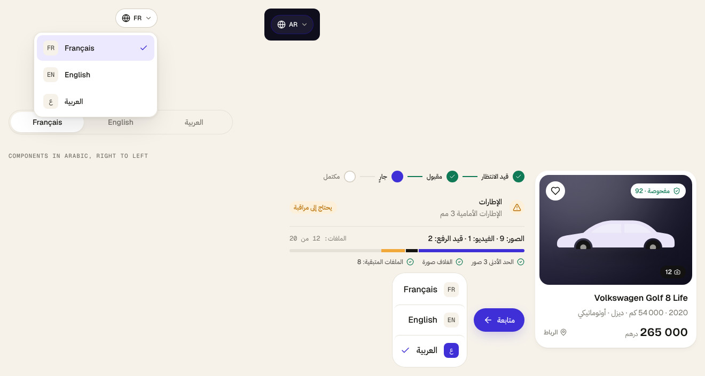

Language switcher for the three API languages: Français (the API default), English and العربية. Each language name is written in its own language and script, so people can find theirs whatever the current UI language.
- `variant="pill"` (default) is the header trigger (globe + code); `open` shows its menu. `NavDesktop` and the main `MobileHeader` include it when given `lang`. `dark` for night bands.
- Every text component takes `lang` and picks its labels from `AutoSouk.I18N` (status, role and verdict words match the API's `enums` catalog). For Arabic put `dir="rtl" lang="ar"` on the page root: rows mirror, overlays use logical insets, arrows and chevrons flip, and letter-spacing is removed.
- `variant="segmented"` for forms (sign-up) and settings; `variant="list"` for mobile settings.
- Switching changes the UI and every API call's `Accept-Language` (or `?lang=`), and sets `<html lang dir>`: `dir="rtl"` for Arabic. The emails and inspection-report PDFs use the language saved on the account at sign-up, which the API does not change afterwards — say so wherever the user picks a language.

## ListingCard

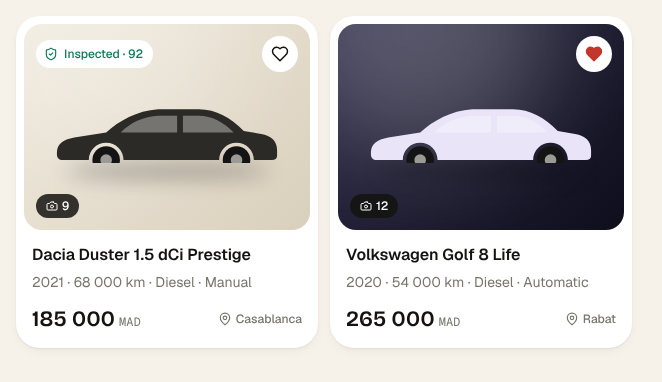

The car card used in every grid: photo with "Inspected · score" badge, favourite heart and photo count; title, meta line (year · mileage · fuel · gearbox), price in MAD and city.

- Omit `inspectedScore` when the car has no completed inspection.
- `favorite` fills the heart in `danger`. Width 302 on desktop grids (4 columns at 1280), 350 on mobile; set `fluid` to fill a CSS grid cell (`repeat(auto-fill, minmax(260px, 1fr))`) so grids reflow at any width.

## Logo

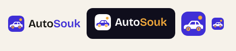

The AutoSouk logo: a white car on a Majorelle rounded tile, riding on two saffron zellige-star wheels, with a saffron 8-point star badge in the corner (the inspected, trusted car). The wordmark sets "Souk" in `brand`.
- Use `tone="light"` on `paper`/`surface`; `tone="dark"` on `night` (the tile turns white, the car `brand`, "Souk" `saffron`).
- Keep at least 8px clear space; never recolour the tile, car or star, never redraw the car, and never set the wordmark in another face.
- `markOnly` for app icons, favicons and tight spots (avatar fallback, map pins). Below 20px, use the mark alone.

## MapView

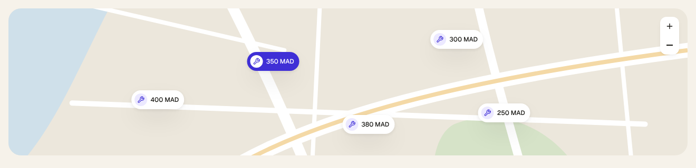

Stylised city map with price pins for garages (`wrench`) or cars (`car`). The active pin is `brand`. Pins take percentage positions; replace with a real map SDK in production but keep the pin style.

## MechanicCard

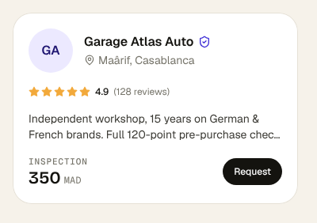

Garage card: initials avatar, name with verified mark, area, rating, two-line description, inspection price and a request action. Used on home, listing detail and rankings.

## MediaLimits

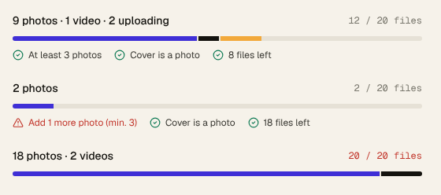

Counter and rules for a car's media: photos, videos and uploads in progress against the 20-file limit, plus the three rules the API enforces (at least 3 photos, the cover is a photo, 20 files max). Rules turn `danger` when broken.
- Show it above every media grid (create listing, edit drawer, manage photos). `compact` keeps only the count and bar.
- Uploads in progress count towards the 20 files but never towards the 3-photo minimum.

## MobileHeader

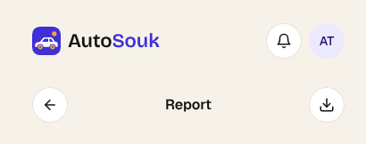

Mobile top bar: `main` (logo, notifications, avatar) on tab roots; `back` (back, centred title, optional action) on pushed screens.

## NavDesktop

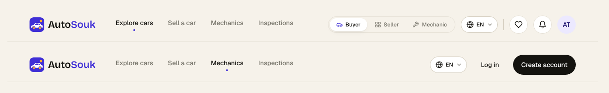

Desktop top bar (76px): logo, primary links with an active dot, role switch, favourites, notifications and avatar — or Log in / Create account for guests.

## Pagination

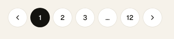

Round page buttons; the current page is `ink`. Listings use `page`/`limit` from the API.

## Radio

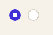

Single choice inside selectable cards (role picker at sign-up, garage picker in the inspection request).

## Rating

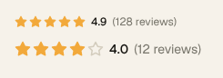

Five saffron stars with the score and an optional review count. Scores come from mechanic reviews (1–5).

## ReviewItem

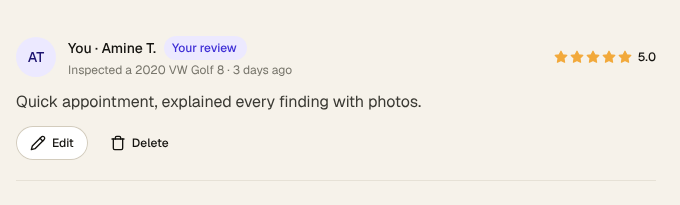

One mechanic review: avatar, name, inspection context, stars and message (≤1000 characters, moderated). The signed-in user's own review shows "Your review" with Edit / Delete.

## RoleSwitch

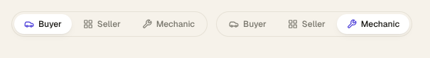

Header toggle between the three perspectives (Buyer, Seller, Mechanic). It changes what the UI shows; permissions are always enforced server-side.

## ScoreRing

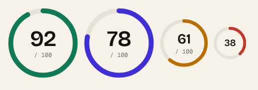

The inspection score (0–100) as a ring coloured by verdict: excellent → `success`, good → `brand`, fair → `warning`, poor → `danger`. Always pair with the verdict word.

## Segmented

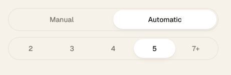

Segmented control for 2–5 mutually exclusive options that fit on one line (transmission, doors, price sort on mobile).

- Fills its container; use Chips when options wrap.

## SpecItem

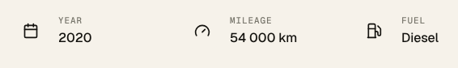

Icon + overline label + value, for car specs (year, mileage, fuel, gearbox, fiscal power, doors, owners, origin, condition) and report facts. Lay them out in a wrapping grid.

## StatCard

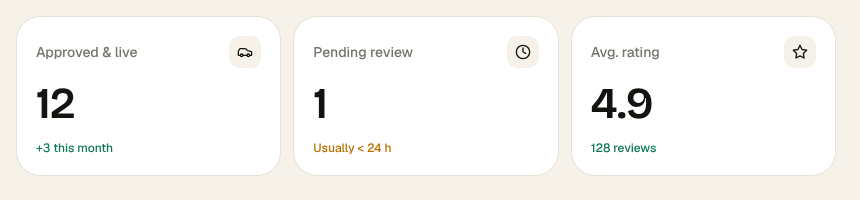

Dashboard number card: label, icon, big value (`display-m`) and a trend line coloured by meaning. Seller dashboard, mechanic queue, admin moderation.

## StatusBar

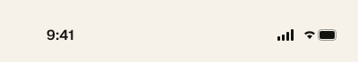

iOS-style status bar for mobile mock-ups (390 wide). `dark` for white glyphs over photos.

## Stepper

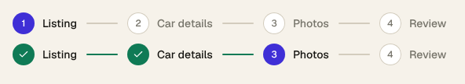

Horizontal step indicator for the 4-step listing flow (Listing → Car details → Photos → Review). Done steps turn `success` with a check, the current step is `brand`.

## TabBar

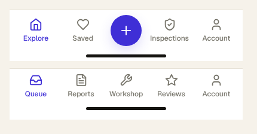

Mobile bottom navigation (86px with home indicator). Buyers/sellers: Explore, Saved, Sell (raised brand button), Inspections, Account. Mechanics: Queue, Reports, Workshop, Reviews, Account.

## Tabs

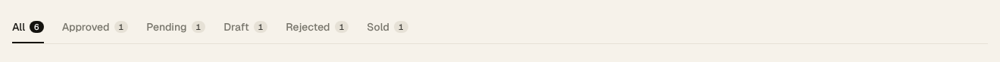

Underline tabs with optional counts — listing statuses, review/garage-photo tabs, inspection filters.

## Toggle

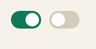

On/off switch, green when on. Used for "Accepting inspection requests", "Inspected only", contrôle technique and vignette validity.

- Pair with a label on the left; the switch sits at the end of the row.

## UploadTile

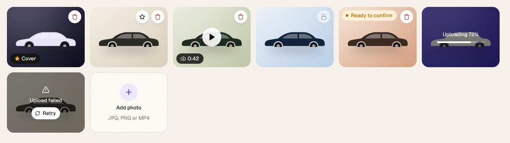

Tile for listing media and garage photos. States: empty (dashed "Add photo"), filled, cover (brand outline + "Cover" tag: the primary image), new ("Ready to confirm": uploaded, hidden until the confirm call), uploading (progress), failed (red outline + Retry: the confirm call returned a fresh upload policy).
- `video` adds a play button and duration pill. A video can never be the cover, so it gets no "Make cover" action.
- `actions` adds "Make cover" (star) next to Delete. Changing the cover or deleting does not send the listing back to review; confirming new uploads does.
- `locked` swaps Delete for a lock when only 3 photos remain: upload and confirm a replacement first.
- `fluid` fills a grid cell at `ratio` (default 4 / 3).

## ZelligePattern

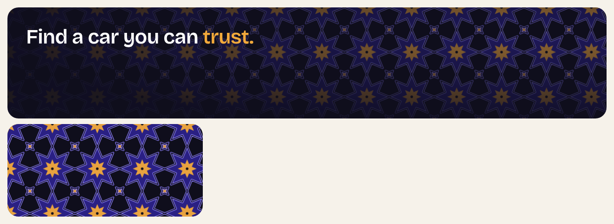

Moroccan zellige tiling used only inside `night` bands (home hero, auth brand panel, report verdict, footer CTA): Majorelle 8-point star rosettes with saffron hearts and crosses, joined by interlaced lavender ribbons. It is drawn with the classic Hankin method on the octagon-square (4.8.8) grid, so it tiles seamlessly at any size.
- Position it absolutely inside a container with `overflow:hidden`, sized to that container (`width`, `height`).
- It fades by default from the top-right corner (`fadeX`/`fadeY` move the bright spot) so headlines on the left stay readable; `fade={false}` for a flat tile. Default opacity 0.6; `scale` 0.6–1.4 changes the tile size.
- Never put it behind body copy on light grounds.
